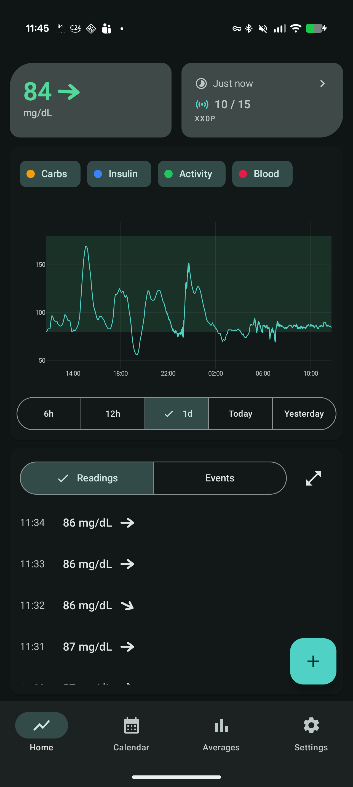
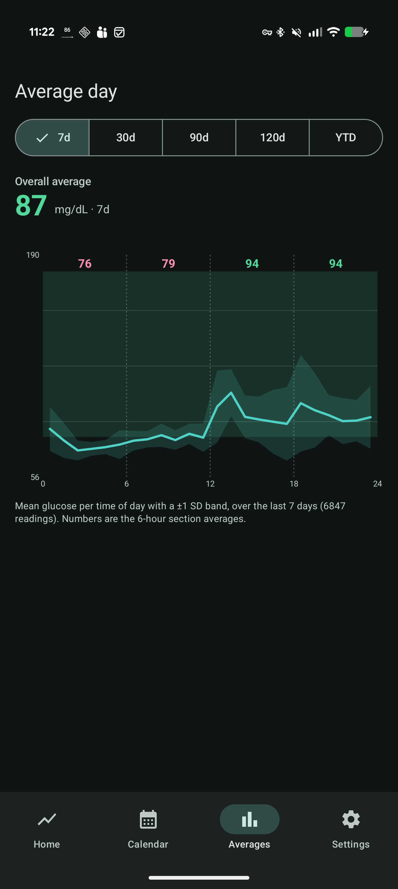
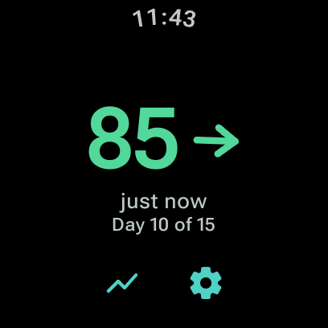

<h1 align="center">Mogluco</h1>

<p align="center">
  <em>A modern, Material 3 redesign of <a href="https://www.juggluco.nl">Juggluco</a>'s phone and WearOS watch app; tested with the Freestyle Libre 3 / 3+.</em>
</p>

<p align="center">
  
  &nbsp;
  
  &nbsp;
  
</p>

<p align="center">
  <a href="#features">Features</a> ·
  <a href="#why-this-fork">Why a fork</a> ·
  <a href="#goals--non-goals">Goals</a> ·
  <a href="#installation">Install</a> ·
  <a href="#documentation">Docs</a> ·
  <a href="#credits--licence">Credits</a>
</p>

---

> [!WARNING]
> **Mogluco is not a medical device.** It is an independent, experimental app, not approved by any regulator and not affiliated with Abbott. Do not make treatment decisions based on it alone.
>
> - **Readings can be wrong, late or missing.** Glucose sensors are not always accurate. When a reading disagrees with how you feel, use a blood-glucose fingerstick.
> - **Alarms can fail.** If the phone restricts Mogluco in the background, blocks its notifications, has Bluetooth off, or is out of the sensor's range, an alarm may not reach you. Do not rely on Mogluco as your only warning of a low.
> - **No warranty.** Mogluco is provided as is, without any warranty (see the [GPLv3](LICENSE.txt)), and may contain bugs. You use it at your own risk.

## What is Mogluco?

Mogluco reads glucose straight from your Libre 3 / 3+ sensor over Bluetooth and shows it in a clean, modern interface:

- A **home screen** with the current value, trend arrow, an interactive graph, and the reading/event list.
- A **calendar** to page back through any day, and an **"average day"** view (7d / 30d / 90d / 120d / YTD) with a mean-±SD profile and time-of-day section averages.
- A **WearOS** companion: live value, trend, a glanceable graph, tile and complications, on-watch alarms, and the ability to hand the sensor connection back and forth with the phone.
- Reliable **background readings and alarms** (low / high / signal-loss), a persistent notification, and an optional always-on-display graph.
- Optional, off-by-default export to **Health Connect** and **LibreView**, plus CSV / TSV and full backup.

No account is needed, and nothing leaves your phone unless you explicitly request it (e.g., pushing sensor data to LibreView).

Mogluco is a [Juggluco](https://www.juggluco.nl) fork and, as such, uses the same sensor communication paths.
It solely packs all functionality into an entirely new Jetpack Compose UI and WearOS app to not only improve the user interface, but also the user experience by simplifying the scanning flow and settings.

## Why this fork?

[Juggluco](https://www.juggluco.nl) is a great help for monitoring blood sugar levels in a privacy-preserving manner on your smartphone and smartwatch.

However, in my opinion in came short in both user interface as well as user experience (requiring complicated setups, with intransparent menus to scan sensors or change settings).
I wanted to build on this and keep the general monitoring capabilities while improving the UI and UX:

1. **A modern look and feel**: a Material 3 interface, a cleaner information hierarchy, and interactions that feel native to a current Android phone.
2. **A proper WearOS experience** on my Pixel Watch 3: live glucose, a readable graph, complications, and on-watch alarms, with the sensor connection able to move between phone and watch.

Rather than rewrite the sensor stack, Mogluco keeps Juggluco's core and rebuilds only the surface: the phone UI and the watch app. That keeps the thing that matters — the sensor data and communication flow — stable, while providing a better user experience.

## Goals & non-goals

**Goals**

- A focused, opinionated, modern **Material 3** UI for viewing Libre 3 / 3+ data.
- A useful WearOS companion.
- **Reliability** of background readings and alarms.
- **Local-first & private**: your data stays on-device unless you explicitly enable an export.

**Non-goals**

- **Not** trying to match every sensor that Juggluco supports. Mogluco is built and tested around **Libre 3 / 3+** as this is what I can test and verify. Other sensor paths inherited from the engine are neither the focus nor verified here.
- **Not** aiming for feature-parity with Juggluco's full menu. It is a deliberately smaller, redesigned subset that I cared about.
- **Not** a cloud service. There is no Mogluco account, server, or telemetry.

## Features

| | |
|---|---|
| **Home** | Current value + rate-arrow, interactive graph (tap-to-inspect, adjustable time windows, configurable no-data gap breaks), reading & event lists |
| **Events** | Log carbs, insulin (fast/slow), dextrose, activity, blood-glucose checks; shown on the graph and in the list |
| **Calendar** | Page any past day; per-day graph, readings and events; sensor timeline |
| **Averages** | "Average day" profile with a ±1 SD band and 6-hour section means over 7 / 30 / 90 / 120 days or year-to-date |
| **Alarms** | Low / high / signal-loss, with snooze, repeat, and an optional Do-Not-Disturb override |
| **Notification & AOD** | Persistent lock-screen reading + mini graph; opt-in always-on-display graph |
| **WearOS** | Live value, trend, glanceable graph, tile & complications, on-watch alarms, phone↔watch sensor hand-off |
| **Export** | Health Connect (opt-in), LibreView, CSV / TSV, and a full backup / restore |
| **Smoothing** | Optional EMA smoothing of the trace, with adjustable strength |

See the [documentation](#documentation) for a guided tour with screenshots.

## Installation

Mogluco is an Android app for a phone running **Android 8.0 (API 26)+**, with an optional **WearOS 3+** companion. It can be installed alongside the original Juggluco.

**Build it from source.** Mogluco reuses Juggluco's sensor engine, which depends on a few closed-source native libraries that belong to Abbott / Juggluco and **cannot be redistributed** — so, like upstream Juggluco, they are not included here and no prebuilt APK is distributed. A helper fetches them from an official Juggluco APK on first build, so the whole flow is:

```bash
git clone https://github.com/woshicado/mogluco.git && cd mogluco
mise run blobs      # one-time: fetch the closed-source sensor libraries
mise run build      # build the phone APK  (also runs `blobs` automatically)
mise run ship       # release-build and install to a connected phone (+ watch)
```

`mise run build` and `mise run ship` invoke the library fetch themselves, so `mise run blobs` is only needed if you want to run it up front. See [`scripts/extract-blobs.sh`](scripts/extract-blobs.sh) for exactly what it downloads.

Full step-by-step install, the library-fetch details, and first-sensor onboarding are in **[the documentation](#documentation)**.

> [!NOTE]
> **"Restricted setting" blocking the accessibility toggle?**
>
> The optional [always-on-display / lock-screen graph](#features) runs as an accessibility service. Because Mogluco is sideloaded (installed outside an app store), Android blocks it from enabling accessibility until you explicitly allow it.
> If the toggle is greyed out or you see *"Restricted setting"*, go to **Settings → Apps → Mogluco → ⋮ (top-right menu) → Allow restricted settings**, then return to Accessibility and enable Mogluco's **Use** toggle.
>
> Official instructions: <https://support.google.com/android/answer/12623953#allowrestrictedsettings>.

## Documentation

A small docs site (installation, onboarding, and a feature tour with screenshots) lives in [`docs/`](docs/) and is published with [MkDocs Material](https://squidfunk.github.io/mkdocs-material/)  at <https://woshicado.github.io/mogluco/>

```bash
pip install -r docs/requirements.txt
mkdocs serve      # preview at http://127.0.0.1:8000
```

## Built with generative AI

Much of Mogluco's redesign were written with the help of **generative AI (specifically Anthropic's Claude Opus 4.8/Fable 5)**, under human direction and review.
Therefore, this fork may contain bugs, and in particular those often encountered when using such models for programming.
While I tried my best to test the app's functionality and work out any bugs, be aware that typical errors may be encountered.

If you encounter any bugs, please reach out so I can look at them and fix them.

## Credits & licence

Thanks to **J. Kaltes** for providing [Juggluco](https://www.juggluco.nl), which has been used as a base for this project, and simplified the development of this project:

- Juggluco website: **https://www.juggluco.nl**
- Juggluco source: **https://github.com/j-kaltes/Juggluco**

Mogluco is a fork and is distributed under the **GNU General Public License v3.0**, the same licence as Juggluco — see [`LICENSE.txt`](LICENSE.txt). It is an independent, non-commercial project and is **not affiliated with or endorsed by Abbott or Juggluco**.

